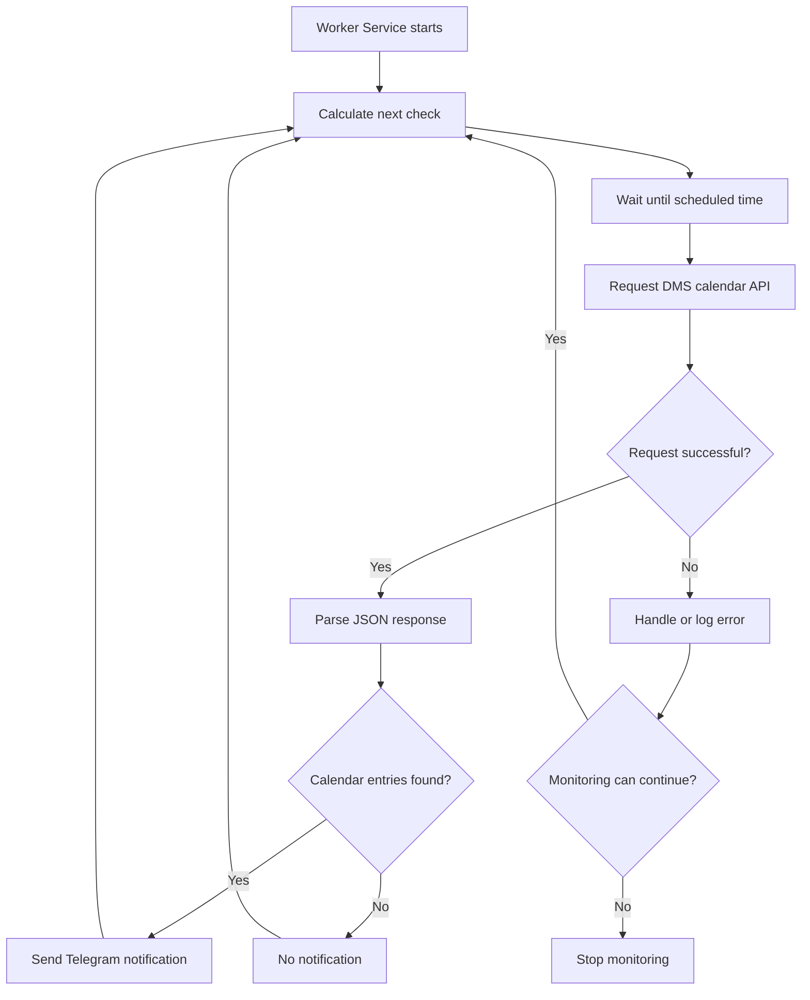

# DMS Queue Monitor

**Automated appointment availability monitoring for Ukraine's State Migration Service (DMS), built with .NET 10 Worker Service, Docker, and Telegram Bot API.**

DMS Queue Monitor is a background application that periodically checks the DMS electronic appointment calendar and sends Telegram notifications when the API returns available calendar entries.

The project was created to solve a practical problem: instead of repeatedly refreshing an appointment booking website, let a background service monitor the calendar automatically.

## Features

- **Automated monitoring** — periodically requests appointment calendar data from the DMS API.
- **Telegram notifications** — sends alerts when calendar entries are detected.
- **Adaptive scheduling** — uses different polling intervals depending on the time of day.
- **Background execution** — runs continuously using .NET `BackgroundService`.
- **Docker support** — containerized deployment with Docker and Docker Compose.
- **Cloud deployment** — deployed on an Oracle Cloud Ubuntu VPS.
- **Configuration management** — keeps Telegram credentials outside source control.
- **Automated tests** — xUnit tests for scheduling logic.

## Tech Stack

| Category | Technologies |
|---|---|
| Language | C# |
| Framework | .NET 10 |
| Application | Worker Service, BackgroundService |
| HTTP | HttpClient |
| JSON | System.Text.Json |
| Notifications | Telegram Bot API |
| Scheduling | Custom time-based scheduler |
| Testing | xUnit |
| Containerization | Docker, Docker Compose |
| Deployment | Oracle Cloud Infrastructure, Ubuntu 24.04 |
| Version Control | Git, GitHub |

## How It Works

The application follows a simple monitoring workflow:

1. The background worker starts and loads its configuration.
2. The scheduler calculates the next check using the `Europe/Kyiv` timezone.
3. The HTTP client requests appointment calendar data from the DMS API.
4. The JSON response is parsed.
5. If the `data` array contains entries, the application sends a Telegram notification.
6. The worker waits until the next scheduled check.

### Monitoring Workflow



## Adaptive Scheduling

The application uses a custom scheduler with the `Europe/Kyiv` timezone.

| Kyiv Local Time | Check Interval |
|---|---|
| 23:00–23:59 | Every 5 minutes |
| 00:00–00:29 | Every 1 minute |
| 00:30–22:59 | Every 10 minutes |

The scheduler is designed to concentrate checks around midnight while reducing requests during the rest of the day.

Polling intervals should be configured and used in accordance with the external service's access policies and rate limits.

## Configuration

The application uses .NET configuration and environment variables.

For Docker deployment, create a `.env` file based on `.env.example`:

```env
TELEGRAM_BOT_TOKEN=your_telegram_bot_token
TELEGRAM_CHAT_ID=your_telegram_chat_id
```

The Docker Compose configuration passes these variables to the .NET application.

**Security:** Never commit real Telegram bot tokens, chat IDs, SSH private keys, or other credentials to Git.

## Running Locally

### Prerequisites

- .NET 10 SDK
- Internet connection
- Telegram bot token and chat ID, if notifications are enabled

### Run the application

Clone the repository:

```bash
git clone https://github.com/VolodiaTutko/DmsQueueMonitor.git
cd DmsQueueMonitor
```

Restore dependencies:

```bash
dotnet restore
```

Configure the required application settings, then start the Worker Service using its project file:

```bash
dotnet run --project path/to/DmsQueueMonitor.Worker.csproj
```

Replace the example project path with the actual location in the repository.

## Docker Deployment

### Build the image

```bash
docker build -t dms-queue-monitor:latest .
```

### Start the service

Make sure the `.env` file is configured, then run:

```bash
docker compose up -d
```

### View logs

```bash
docker compose logs -f dms-monitor
```

### Stop the service

```bash
docker compose stop dms-monitor
```

### Restart the service

```bash
docker compose restart dms-monitor
```

The deployment uses Docker's `unless-stopped` restart policy to support recovery after unexpected container or host restarts.

## Testing

The project uses **xUnit** to test scheduling behavior.

Covered scenarios include:

- Correct intervals for different time windows.
- Time boundary transitions.
- Scheduling around midnight.
- Next-check calculations.

Run the tests:

```bash
dotnet test
```

During development, the scheduling test suite passed **14 tests**.

## Deployment Environment

The application has been deployed to an Oracle Cloud Infrastructure virtual machine.

| Component | Environment |
|---|---|
| Cloud provider | Oracle Cloud Infrastructure |
| Operating system | Ubuntu 24.04 LTS |
| Compute instance | VM.Standard.E2.1.Micro |
| Container runtime | Docker Engine |
| Orchestration | Docker Compose |
| Application runtime | .NET 10 |

The Worker Service runs inside a Docker container, allowing monitoring to continue independently of the developer's local computer.

## Implementation Highlights

**Background processing:** The monitoring process is implemented as a hosted background service rather than an interactive application.

**HTTP integration:** A typed `HttpClient` is used to communicate with the external calendar endpoint.

**JSON processing:** `System.Text.Json` is used to deserialize the API response.

**Timezone-aware scheduling:** The application calculates monitoring times using Kyiv local time rather than relying on the server's system timezone.

**Notification integration:** Telegram Bot API provides a lightweight channel for delivering monitoring results.

**Deployment:** Docker simplifies running the same application across local and cloud environments.

## Limitations and Disclaimer

- This is an independent educational and personal automation project.
- It is **not affiliated with or endorsed by the State Migration Service of Ukraine**.
- The application depends on an external API whose structure, availability, and access policies may change.
- A nonempty calendar response indicates returned calendar entries; it does not independently guarantee that a specific appointment slot can be booked.
- The application does not book appointments automatically.
- Monitoring must respect applicable service terms and rate limits.

## Future Improvements

- Configurable monitoring schedules.
- Support for multiple DMS offices.
- Improved duplicate-notification prevention.
- Persistent monitoring state.
- Structured monitoring metrics and health checks.
- CI/CD automation with GitHub Actions.
- Additional integration tests.

## Author

**Volodymyr Tutko**
